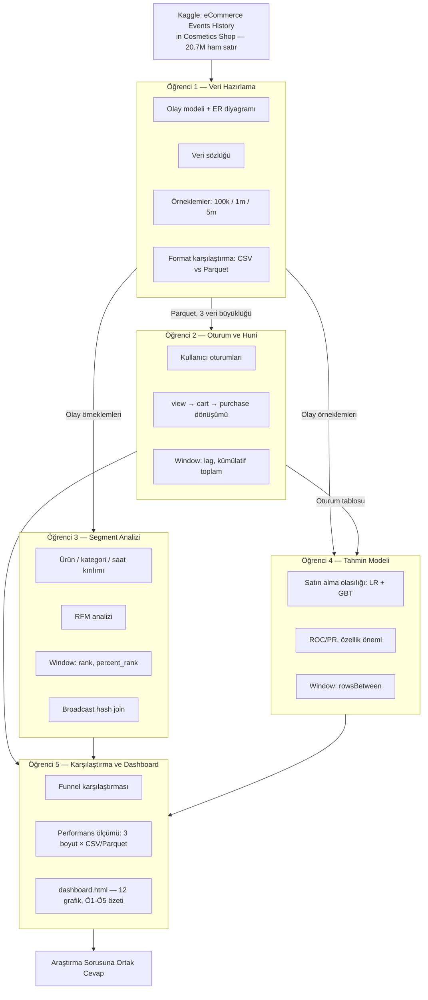
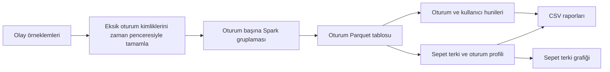
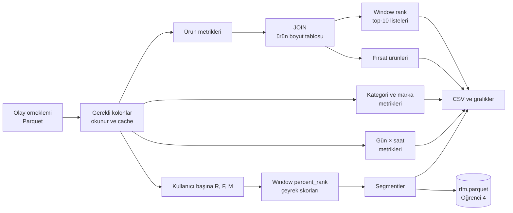
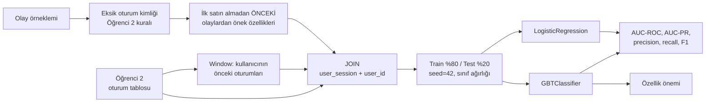
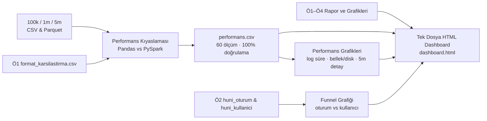

# Proje 3 – E-Ticaret Müşteri Davranışı Analitiği

## Mimari



Ham veri Öğrenci 1 tarafından Parquet formatına dönüştürülüp üç farklı büyüklükte (100k/1m/5m) örneklenir. Öğrenci 2 bu örneklemlerden kullanıcı oturumlarını ve dönüşüm hunisini çıkarır. Öğrenci 3 olay örneklemleri üzerinde ürün, kategori, saat ve RFM segment analizi yapar; Öğrenci 4 Öğrenci 2'nin oturum tablosuyla satın alma tahmin modelini kurar. Öğrenci 5 tüm sonuçları birleştirip performans karşılaştırmasını ve nihai dashboard'u üretir.

**Büyük Veri Analitiği – 2026-2027 Güz** · Selçuk Üniversitesi Teknoloji Fakültesi Bilgisayar Mühendisliği

**Araştırma sorusu:** Büyük clickstream verisinden satışa dönüşümü artıracak hangi bilgiler çıkarılabilir?

> **Gruba yeni katılıyorsan önce [`docs/BASLANGIC.md`](docs/BASLANGIC.md)'yi oku.**
> Kendi görevin ve agent promptun: [`docs/gorevler/`](docs/gorevler/) ·
> Sınav soruları: [`docs/sinav_sorulari.md`](docs/sinav_sorulari.md)

## Veri seti

| | |
|---|---|
| Ad | eCommerce Events History in Cosmetics Shop |
| Kaynak | Kaggle – https://www.kaggle.com/datasets/mkechinov/ecommerce-events-history-in-cosmetics-shop |
| Sağlayıcı | REES46 / Open CDP projesi |
| Dönem | Ekim 2019 – Şubat 2020 (5 aylık CSV) |
| Kolonlar | `event_time, event_type, product_id, category_id, category_code, brand, price, user_id, user_session` |
| Olay tipleri | `view`, `cart`, `remove_from_cart`, `purchase` |

Daha büyük ölçek gerekirse aynı şemadaki *eCommerce behavior data from multi category store* seti
(`bash scripts/download_data.sh multi`) kod değişikliği olmadan kullanılabilir.

## Kurulum

```bash
python -m venv .venv && source .venv/bin/activate      # Windows: .venv\Scripts\activate
pip install -r requirements.txt
# Java 17+ gerekli (PySpark için):  java -version
```

Kaggle API anahtarı: Kaggle → Settings → API → *Create New Token* → `kaggle.json` dosyasını
`~/.kaggle/` (Windows: `C:\Users\<ad>\.kaggle\`) altına koy.

```bash
bash scripts/download_data.sh          # data/raw/*.csv
bash scripts/run_ogrenci1.sh           # hazırlama + örneklemler + raporlar
```

Kaggle CLI kullanmadan: sayfadan zip'i elle indirip CSV'leri `data/raw/` içine atman yeterli.

Takım içi hızlı kurulum için `docs/BASLANGIC.md`'de belirtilen Drive'daki `samples.zip` dosyası da kullanılabilir;
bu durumda Kaggle'dan tekrar indirme ve `scripts/run_ogrenci1.sh` çalıştırma adımları atlanabilir, zip doğrudan
`data/processed/samples/{100k,1m,5m}/` altına açılır.

## Klasör yapısı

```
data/raw/                      Kaggle CSV'leri (git'e girmez)
data/processed/events_full/    temiz olay tablosu, Parquet, event_month partition'lı
data/processed/dim_product/    ürün boyut tablosu
data/processed/samples/{100k,1m,5m}/events.parquet | events.csv
docs/olay_modeli.md            olay tipleri, huni, varlık ilişkileri, hazırlama kararları
docs/veri_sozlugu.md           otomatik üretilen veri sözlüğü
reports/ogrenci1/              kalite özeti, örneklem özeti, format karşılaştırması, grafikler
src/ogrenci1/                  Öğrenci 1 kodu
tools/generate_test_data.py    sadece test: aynı şemada sentetik veri
```

## Diğer öğrenciler veriyi nasıl kullanır?

```python
from src.ogrenci1.common import get_spark, PATHS

spark = get_spark()
df = spark.read.parquet(str(PATHS["samples"] / "1m" / "events.parquet"))   # veya PATHS["events"] (tam veri)
df.groupBy("event_type").count().show()
```

Pandas ile: `pd.read_parquet("data/processed/samples/1m/events.parquet")` veya `pd.read_csv(".../events.csv")`.

---

## Öğrenci 1 – Veri hazırlama ve olay modelleme

**Görev:** Clickstream/e-commerce veri setini hazırlar ve olay türlerini modeller.

| Adım | Script | Çıktı |
|---|---|---|
| 1. Temin | `scripts/download_data.sh` | `data/raw/*.csv` |
| 2. Hazırlama + olay modeli | `src/ogrenci1/prepare_data.py` | `events_full/`, `dim_product/`, `kalite_ozeti.csv` |
| 3. 100K / 1M / 5M örneklem | `src/ogrenci1/make_samples.py` | `samples/*`, `orneklem_ozeti.csv` |
| 4. Veri sözlüğü + format/boyut analizi | `src/ogrenci1/profile_data.py` | `veri_sozlugu.md`, `format_karsilastirma.csv`, grafikler |

Öne çıkan kararlar (ayrıntısı `docs/olay_modeli.md`'de):

- **Açık şema**, `inferSchema` yok; zaman UTC'ye sabit.
- Her olaya `funnel_step` (1/2/3) ve `is_view/is_cart/is_remove/is_purchase` bayrakları eklendi.
- `category_code` → `category_l1/l2/l3`.
- Örneklemler **kullanıcı bazlı** alındı. Bir kullanıcı seçildiyse tüm geçmişi gelir, böylece oturumlar bölünmez.
  Örneklemler iç içe (100k ⊂ 1m ⊂ 5m) ve `seed=42` ile tekrarlanabilir.
- Her örneklem hem **CSV** hem **Parquet** olarak yazıldı (format karşılaştırması şartı).

### Sonuçlar

Ortam: Windows 11, 32 GB RAM, PySpark 4.3 (local[*], driver 12 GB), Java 17.

**Veri kalitesi** (`reports/ogrenci1/kalite_ozeti.csv`)

| Metrik | Değer |
|---|---|
| Ham satır (5 ay) | 20.692.840 |
| Birebir tekrar eden olay (silindi) | 1.109.092 |
| Negatif fiyat (silindi) | 131 |
| Boş oturum (tutuldu) | 4.598 |
| Geçersiz zaman / olay tipi / boş user-ürün | 0 |
| **Temiz satır** | **19.583.617** (%5,36 elendi) |
| Hazırlama süresi | 134,7 sn |

Elenen satırların neredeyse tamamı tekrar eden olaylar. Aynı kullanıcı, aynı saniyede, aynı ürüne aynı olayı
birden fazla kez üretmiş görünüyor; büyük ihtimalle istemci tarafında çift kayıt. Silinmeseler sepet ve görüntüleme
sayıları şişecek, dönüşüm oranları olduğundan düşük çıkacaktı.

**Olay dağılımı** (`olay_dagilimi_aylik.csv`, `olay_dagilimi.png`)

| Olay | Sayı | Pay |
|---|---|---|
| view | 9.656.788 | %49,3 |
| cart | 5.652.991 | %28,9 |
| remove_from_cart | 2.987.855 | %15,3 |
| purchase | 1.285.983 | %6,6 |

- Olay bazında her 100 görüntülemeye ~58 sepete ekleme ve ~13 satın alma düşüyor. Sepete eklemelerin ~%53'ü
  kadar sepetten çıkarma var. Kozmetikte kullanıcılar sepeti "liste" gibi kullanıyor olabilir; oturum bazlı
  gerçek dönüşüm Öğrenci 2'nin analizinde hesaplanacak.
- En yoğun ay Kasım 2019 (4,39M olay, 322K satın alma), en sakin ay Aralık 2019 (3,35M). Kasım'daki artış
  kampanya dönemiyle (Black Friday) ilişkili olabilir; bu bir hipotez, veri tek başına nedenini göstermiyor.

**Veri sözlüğünden öne çıkanlar** (`docs/veri_sozlugu.md`)

- `category_code` satırların **%98,25'inde boş**. Kategori analizlerinde `category_code` yerine `category_id`
  (500 farklı değer) kullanılmalı.
- `brand` %42,2 boş, 293 marka var.
- `price` en düşük 0,0. Sıfır fiyatlı ürünler hatalı sayılmadı (numune/hediye olabilir); fiyat analizlerinde dikkat.
- 1,57M kullanıcı, 4,83M oturum, 54K ürün. (Farklı değer sayıları `approx_count_distinct` ile yaklaşık
  hesaplandı; ör. `event_hour` 25 görünüyor ama gerçekte 24.)

**Örneklemler** (`orneklem_ozeti.csv`)

| Örneklem | Satır | Kullanıcı | Oturum | Ürün | Satın alma |
|---|---|---|---|---|---|
| 100k | 99.959 | 9.366 | 24.490 | 18.899 | 6.104 |
| 1m | 999.932 | 85.132 | 235.015 | 41.796 | 65.284 |
| 5m | 4.999.968 | 411.547 | 1.165.961 | 49.879 | 324.081 |

Satır sayıları hedefin hemen altında: kullanıcıların tüm geçmişi alındığı için hedefi aşmayan son kullanıcıda
duruluyor. Ürün sayısı satırla doğrusal artmıyor (100k→5m: 50 kat satır, 2,6 kat ürün); popüler ürünler küçük
örneklemde bile görünüyor.

**CSV vs Parquet** (`format_karsilastirma.csv`, `format_boyut.png`, `format_sure.png`; süreler 3 tekrarın medyanı)

| Örneklem | Format | Disk (MB) | count (sn) | avg(price) (sn) | groupBy(event_type) (sn) |
|---|---|---|---|---|---|
| 100k | CSV | 16,6 | 0,28 | 0,36 | 0,36 |
| 100k | Parquet | 3,0 | 0,22 | 0,26 | 0,28 |
| 1m | CSV | 165,4 | 0,27 | 0,41 | 0,40 |
| 1m | Parquet | 40,3 | 0,23 | 0,25 | 0,28 |
| 5m | CSV | 827,2 | 0,46 | 1,03 | 1,30 |
| 5m | Parquet | 206,5 | 0,32 | 0,27 | 0,57 |

Tam veride ham CSV 2.434 MB, temiz Parquet 822 MB (**2,96 kat** küçük), üstelik Parquet'te 9 yerine 22 kolon var.

**Neden böyle çıktı?**

1. **Parquet ~4 kat küçük:** Kolon bazlı saklıyor. Aynı kolondaki benzer değerler (ör. sadece 4 farklı değeri olan
   `event_type`, tekrar eden `user_session`) yan yana durunca sözlük kodlaması + Snappy sıkıştırması çok iyi
   çalışıyor. CSV her değeri metin olarak tekrar tekrar yazıyor.
2. **Tek kolon sorgusunda Parquet'in süresi sabit kalıyor (0,25–0,27 sn), CSV'ninki büyüyor (0,36 → 1,03 sn):**
   `avg(price)` için Parquet sadece `price` kolonunu okuyor (column pruning). CSV'de kolon kavramı olmadığı için
   her satırın tamamı okunup parse edilmek zorunda.
3. **groupBy farkı daha az (1,30'a karşı 0,57 sn):** Burada iki tarafta da gruplama/shuffle maliyeti var; okuma
   avantajı farkın sadece bir kısmını oluşturuyor.
4. **100k ve 1m'de iki format neredeyse aynı:** Bu boyutlarda süreyi veri değil, Spark'ın her iş için harcadığı
   sabit başlatma/planlama maliyeti (~0,2 sn) belirliyor. Fark ancak 5m'de belirginleşiyor. Veri büyüdükçe
   Parquet'in avantajı artacaktır; tam veride (19,6M) fark daha da açılır.
5. **count'ta fark küçük:** Parquet satır sayısını dosya üst verisinden (footer) okuyabiliyor; CSV'de satırları
   saymak için dosyanın taranması gerekiyor ama parse gerekmediği için bu da görece hızlı.

Ayrıntılı Pandas/Spark ve bellek karşılaştırması Öğrenci 5'in bölümünde.

## Öğrenci 2 – Oturumlar ve dönüşüm

PySpark ile kullanıcı oturumları oluşturuldu. Oturum ve kullanıcı bazında görüntüleme → sepet → satın alma
dönüşümü, sepetten çıkarma ve sepet terki hesaplandı. Girdi olarak Öğrenci 1'in REES46 kozmetik mağazası
verisinden hazırladığı kullanıcı bazlı 100k, 1m ve 5m Parquet örneklemleri kullanıldı.
[Kaggle veri kümesi](https://www.kaggle.com/datasets/mkechinov/ecommerce-events-history-in-cosmetics-shop)



### Çalıştırma

Repo kökünde, projenin Python ortamı etkin durumdayken çalıştırın.

```bash
python -m src.ogrenci2.sessions
python -m src.ogrenci2.conversion
```

İlk komut varsayılan olarak `data/processed/samples/` dizinini okur. Veri başka yerdeyse
`python -m src.ogrenci2.sessions --samples-dir "../samples/samples"` gibi `100k`, `1m` ve `5m`
klasörlerini içeren dizini belirtin. İki modülde de `--sizes 100k` ile yalnızca ilk örneklem seçilebilir.
Dönüşüm komutu CSV ve grafikleri seçilen örneklemler için yeniden yazar.

Oturum tabloları `data/processed/sessions/{100k,1m,5m}/sessions.parquet` altında oluşur. Öğrenci 4 ve 5
bu tabloları doğrudan okuyabilir. Saat ve haftanın günü UTC'dir (`1 = Pazar`, `7 = Cumartesi`).

### Hesaplama kuralları

- Kaynaktaki dolu `user_session` kimlikleri korunur. Oturumlar `user_id` ve `user_session` birlikte kullanılarak
  gruplanır. Eksik kimliği olan kullanıcının olayları zaman sırasına konur. `lag` ve kümülatif toplam ile ardışık
  olaylar arasında **30 dakikayı aşan** boşlukta yeni blok açılır. Blokta tek bir bilinen kimlik varsa eksik
  olaylar o oturuma katılır. Blokta kimlik yoksa veya birden fazla kimlik varsa eksik olaylara blok için üretilen
  bir kimlik verilir. [Spark `lag` belgeleri](https://spark.apache.org/docs/4.0.1/api/python/reference/pyspark.sql/api/pyspark.sql.functions.lag.html)
- Huni aşama varlığına dayanır. `huni_sayisi` sırasıyla `view`, `view ∩ cart` ve `view ∩ cart ∩ purchase`
  gruplarını sayar. `bagimsiz_sayi` ise her aşamaya ulaşan bütün oturumları veya kullanıcıları içerir.
  Kullanıcı hunisi aşamaları farklı oturumlardan birleştirebilir. Huni olay sırası ve ürün eşleşmesi gerektirmez.
- Sepet terki, en az bir `cart` olayı bulunan oturumlar içinde hiç `purchase` olayı bulunmayanların payıdır.
  Sepetten çıkarma hem `remove_from_cart / cart` olay oranıyla hem de çıkarma görülen sepetli oturumların
  payıyla ölçülür. Satın almaya kadar geçen süre, satın alan oturumlarda ilk olay ile ilk satın alma arasındadır.
  Medyanlar Spark `percentile_approx` ile hesaplanır.

### Çıktılar

- [Oturum özeti ve süreler](reports/ogrenci2/oturum_ozeti.csv)
- [Oturum hunisi](reports/ogrenci2/huni_oturum.csv) ve [kullanıcı hunisi](reports/ogrenci2/huni_kullanici.csv)
- [Olay bazlı oranlar](reports/ogrenci2/olay_oranlari.csv) ve [oturum başına olay sayısı dağılımı](reports/ogrenci2/oturum_olay_dagilimi.csv)
- [Sepet terki profili](reports/ogrenci2/sepet_terki.csv) ve [grafiği](reports/ogrenci2/sepet_terki.png)

### Sonuçlar

| Örneklem | Olay | Oturum | Oturum hunisi view → purchase | Kullanıcı hunisi view → purchase | Sepet terki | Oturum tablosu süresi |
|---|---:|---:|---:|---:|---:|---:|
| 100k | 99.959 | 24.497 | %2,38 | %6,45 | %87,40 | 8,31 sn |
| 1m | 999.932 | 235.059 | %2,46 | %6,48 | %87,37 | 5,63 sn |
| 5m | 4.999.968 | 1.166.225 | %2,46 | %6,58 | %87,15 | 28,62 sn |

- **Olay ve oturum oranları farklı davranışları ölçüyor.** 5m'de 100 görüntüleme olayına 57,94 sepete ekleme
  olayı düşüyor. Görüntüleme yapılan 100 oturumun ise 18,16'sında sepete ekleme görüldü. Bir oturum çok sayıda
  sepete ekleme üretebildiği için olay oranı, sepete ekleme yapan oturumların payından yüksek.
- **Kullanıcı hunisinin dönüşümü daha yüksek.** Örneğin bir kullanıcı ürünü bir oturumda görüntüleyip sonraki
  oturumlarında sepete ekleyebilir ve satın alabilir. Kullanıcı bazlı örnekleme tüm geçmişi koruduğu için huni
  oranları üç farklı boyutta birbirine yakın kaldı.
- **Sepeti terk eden ve satın alan oturumların profilleri farklı.** 5m'de sepeti terk eden 217.495 oturumda
  oturum başına ortalama 11,6 olay var. Sepete ekleyip satın alan 32.080 oturumda bu değer 29,5. Çıkarma olayı
  sepetli oturumların %39,45'inde görülüyor. İlk satın almaya kadar geçen süre ortalama 6 sa. 55 dk., medyan
  13 dk. 15 sn. Kaynak kimliğiyle gruplanan bazı oturumlarda ilk ve son olay arasında günler var (en uzun
  oturum yaklaşık 151 gün). Bu dağılımda tipik satın alma süresini medyan daha iyi yansıtıyor.
- **Eksik kimlikli olaylar korundu.** 5m'deki 1.061 olayın 459'u mevcut oturumlara atandı. Kalan 602 olay
  için 236 oturum kimliği üretildi.

Süreler Windows 11, Ryzen 7 6800H, 16 GB RAM, Java 17 ve PySpark 4.3 ortamında, `local[*]` ve 4 GB Spark sürücü
belleğiyle tek geçişte ölçüldü. Süre Parquet okumadan oturum Parquet'inin yazımı tamamlanana kadar geçen zamanı
kapsıyor. Küçük bir Spark işiyle ısınma yapıldı. 100k'nın 1m'den yavaş çıkmasında ilk Parquet okuma, sorgu
planlama ve JVM ısınma maliyetleri etkili olabilir. 5m'de daha büyük gruplama ve bölümleme işi ile daha fazla
Parquet yazımı toplam süreyi artırıyor.

Ö2'nin tek seferlik ölçümü örneklem başına uçtan uca oturum tablosu üretim süresini gösteriyor. Ö3 ve Ö5 kıyaslamada çalıştırmalar arası oynaklığı azaltmak için üç tekrarın medyanını kullanıyor.

### Neden böyle çıktı?

100k, 1m ve 5m örneklemlerinde oturum hunisinin view → cart dönüşümü sırasıyla %18,09, %18,49 ve %18,16,
cart → purchase dönüşümü %13,14, %13,30 ve %13,55. Kullanıcı hunisinde aynı oranlar view → cart için
%22,87, %22,55 ve %22,54, cart → purchase için %28,20, %28,74 ve %29,20. Üç örneklemin tamamında
önceki aşamaya göre oransal kayıp oturum hunisinde cart → purchase, kullanıcı hunisinde view → cart adımında
daha büyük. İlk aşamanın tabanı daha geniş olduğu için kaybedilen oturum ve kullanıcı sayısı ise view → cart
adımında daha yüksek.

Ürün ve fiyat karşılaştırması, görüntülemelerin bir bölümünün sepete eklemeye dönüşmemesini açıklayabilir.
Kargo ücreti veya ödeme sırasında yaşanan zorluklar, sepetli oturumların satın almayla sonuçlanmamasının olası
nedenleri. Kullanıcı hunisi farklı oturumlardaki olayları birleştirdiği için sonraki ziyaretlerdeki satın almaları da
kapsıyor. Ödeme adımlarının etkisini sınamak için bu kozmetik mağazasının olay kayıtlarına ek veri gerekir.

### Araştırma sorusuna katkı

Kullanıcı bazında en büyük oransal kayıp görüntülemeden sepete geçişte olduğu için ürün sayfası veya fiyat
sunumu değişikliklerinin etkisi view → cart oranıyla sınanabilir. Sepet hatırlatmalarının etkisi, farklı
ziyaretleri kapsayan kullanıcı bazlı cart → purchase oranıyla ölçülebilir.

**Avantaj ve dezavantaj.** Oturum hunisi tek ziyarette hangi aşamada kayıp olduğunu gösteriyor. `lag` ve
kümülatif toplam, olayları zaman sırasına göre bloklayarak eksik kimlikli olayları analize katmayı sağlıyor.
Eksik kimlikler için seçilen 30 dakikalık eşik, aynı ziyareti bölebilir veya ayrı ziyaretleri birleştirebilir.
Huni farklı sırada gerçekleşen veya farklı ürünlere ait olayları aynı dönüşümde sayabilir. Pencere fonksiyonları
için verinin kullanıcıya göre yeniden dağıtılması (shuffle) ve sıralanması, veri büyüdükçe maliyeti artırıyor.

## Öğrenci 3 – Spark ile ürün/kategori/saat/segment analizi

PySpark ile olaylar dört boyutta incelendi: ürün, kategori/marka, haftanın günü × saat ve müşteri segmenti (RFM).
Her boyutta aynı metrikler (view, cart, remove_from_cart, purchase, gelir ve dönüşüm oranları) tek bir `groupBy`
geçişinde hesaplandı. Girdi olarak Öğrenci 1'in 100k, 1m ve 5m Parquet örneklemleri kullanıldı. Amaç, araştırma
sorusuna "dönüşümü hangi ürün, kategori, saat ve müşteri grubu taşıyor, hangisi kaybettiriyor?" sorusuyla katkı
vermek.



### Çalıştırma

```bash
python -m src.ogrenci3.analiz                               # sadece 100k
python -m src.ogrenci3.analiz --sizes 100k 1m 5m --repeat 3  # raporlanan sonuçlar
```

Çıktılar `reports/ogrenci3/` altına yazılır. Aynı CSV'de üç boyut birlikte tutulur (`boyut` kolonu), yalnızca
çalıştırılan boyutların satırları yenilenir. RFM tablosu `data/processed/rfm/{100k,1m,5m}/rfm.parquet` altında oluşur
(`user_id, recency, frequency, monetary, segment, R, F, M`).

### Hesaplama kuralları

- **Dönüşüm** `purchase / view` (olay bazlı), **kullanıcı dönüşümü** satın alan tekil kullanıcı / görüntüleyen tekil
  kullanıcıdır. **Gelir** satın alma olaylarındaki `price` toplamıdır (veride miktar kolonu yok).
- **Kategori** `category_code` %98 boş olduğu için `category_id` ile gruplanır. Kod etiketi, dolu satırlardan ayrı
  küçük bir tabloda hesaplanıp join ile eklenir. **Marka** boş olanlar `(bos)` grubunda tutulur.
- **Ürün boyut tablosu** (`dim_product`) Drive'da olmadığı için Öğrenci 1'in tanımıyla örneklemden üretildi: ürünün en
  son görülen kategori, marka ve fiyatı (`max_by`). Ürün metrikleri bu tabloyla birleştirilir. Spark bu join için
  `BroadcastHashJoin` seçti ([join_plani.txt](reports/ogrenci3/join_plani.txt)). Küçük tablo her göreve
  kopyalandığı için büyük tablo shuffle edilmedi.
- **Top-10 listeleri** (en çok görüntülenen, sepete eklenen, satın alınan, gelir) `rank` window fonksiyonuyla
  çıkarıldı. Dört liste alt alta konup `liste` kolonuyla bölümlendiği için tek window işi yeterli oldu.
- **Fırsat ürünleri** görüntülenmede üst %10'luk dilimdeki ürünler içinde dönüşümü medyanın altında kalanlardır.
  `potansiyel_ek_satis` dönüşüm medyana çıksaydı kazanılacak ek satıştır. Az görüntülenen ürünler dışarıda bırakılır,
  çünkü oranları gürültülüdür (3 görüntüleme, 1 satış = %33).
- **Saat ve gün** UTC'dir. Isı haritasında 100'den az görüntülemeli hücrelerin dönüşümü gösterilmez.
- **RFM.** Recency, 2020-02-29'dan son satın almaya kadar geçen gündür. Frequency, satın alma yapılan oturum (sipariş)
  sayısıdır. Ürün adedi kullanılmadı, çünkü tek siparişte 5 ürün alan biri "5 kez almış" sayılırdı. Monetary,
  toplam harcamadır. Skorlar 1–4 arası çeyreklerdir ve `percent_rank` window fonksiyonuyla hesaplanır.
  [`ntile`](https://spark.apache.org/docs/3.5.1/api/python/reference/pyspark.sql/api/pyspark.sql.functions.ntile.html)
  kullanılmadı, çünkü alıcıların çoğu 1 sipariş verdiği için aynı değerdeki müşterileri keyfi olarak farklı
  çeyreklere bölerdi. [`percent_rank`](https://spark.apache.org/docs/3.5.1/api/python/reference/pyspark.sql/api/pyspark.sql.functions.percent_rank.html)
  ise eşit değerlere aynı sırayı verir. Segment kuralları sırasıyla şöyle:

  | Segment | Kural |
  |---|---|
  | Şampiyon | R ≥ 3, F ≥ 3, M ≥ 3 |
  | Sadık | F ≥ 3 |
  | Risk altında | R ≤ 2, M ≥ 3 |
  | Yeni / umut veren | R ≥ 3 |
  | Uykuda | diğer alıcılar |
  | Hiç almamış – sepete eklemiş / sadece gezmiş | satın alması olmayanlar |

- **Süre** her adımın 3 tekrarının medyanıdır. Her tekrarda sorgu sıfırdan kurulur. Aynı DataFrame tekrar
  çalıştırılırsa Spark önceki shuffle çıktılarını yeniden kullanır ve süre yapay olarak düşer. İlk denemede ürün
  adımı 5m'de 12,9 sn iken tekrarlarda 0,12 sn ölçülmüştü. Bu yüzden ölçüm bu kurala göre düzeltildi.

### Çıktılar

- [Top-10 ürünler](reports/ogrenci3/top_urunler.csv) ve [fırsat ürünleri](reports/ogrenci3/firsat_urunleri.csv)
- [Kategori dönüşümü](reports/ogrenci3/kategori_donusum.csv) ve [grafiği](reports/ogrenci3/kategori_donusum.png),
  [marka dönüşümü](reports/ogrenci3/marka_donusum.csv)
- [Gün × saat tablosu](reports/ogrenci3/saat_gun.csv) ve [ısı haritası](reports/ogrenci3/saat_gun_isi_haritasi.png)
- [RFM segmentleri](reports/ogrenci3/rfm_segmentler.csv) ve [grafiği](reports/ogrenci3/segment_dagilimi.png)
- [Süreler](reports/ogrenci3/sureler.csv) ve [grafiği](reports/ogrenci3/sureler.png),
  [join fiziksel planı](reports/ogrenci3/join_plani.txt)

### Sonuçlar

Toplam olay sayıları üç boyutta da Öğrenci 1'in örneklem özetiyle aynıdır (5m: 2.478.811 view, 324.081 purchase).

| Örneklem | Alıcı kullanıcı payı | Şampiyon: kullanıcı / harcama payı | Risk altında: kullanıcı / harcama payı | Sepete ekleyip hiç almayan |
|---|---:|---:|---:|---:|
| 100k | %6,6 | %0,8 / %30,2 | %1,3 / %24,8 | %18,1 |
| 1m | %6,7 | %0,9 / %35,3 | %1,2 / %21,4 | %17,8 |
| 5m | %6,8 | %0,9 / %37,0 | %1,2 / %20,5 | %17,7 |

- **Harcama birkaç segmentte toplanıyor.** 5m'de Şampiyon, Sadık ve Risk altında segmentleri kullanıcıların
  %2,6'sı, ama harcamanın %68,6'sını yapıyor. Şampiyonların ortalama sipariş sayısı 3,4, ortalama harcaması 159,3.
- **Kaybedilmek üzere olan değerli müşteriler var.** Risk altındaki 4.902 müşteri harcamanın %20,5'ini yapmış.
  Ortalama 110 gündür alışveriş yapmıyorlar.
- **En büyük kitle niyet gösterip almayanlar.** Kullanıcıların %17,7'si (5m'de 72.732 kişi) sepete ekleyip hiç
  satın almamış. Bu kişiler ortalama 9,1 görüntüleme yapmış, sadece gezenler ise 2,4.
- **Trafik zirvesi ile satın alma zirvesi farklı saatlerde.** Görüntüleme en çok 19:00 UTC'de (166.637), ama bu
  saatin dönüşümü %11,5 ile günün en düşüğü. Satın alma en çok 11:00 UTC'de (22.085), dönüşüm %14,8. Günlere
  göre en yüksek dönüşüm Cuma'da (%14,1), en düşük hafta sonunda (%12,2).
- **Çok görüntülenen kategorilerin dönüşümü çok farklı.** 20 binden fazla görüntülenen 23 kategoride dönüşüm %1,4 ile
  %39,7 arasında değişiyor. `…6300255120` kategorisi 70.224 görüntüleme ile %1,4 dönüşümde kalıyor, ama yüksek
  fiyatlı ürünleri yüzünden gelirin %5,7'sini getiriyor. 5m'deki ilk 8 fırsat ürününün 4'ü bu kategoride. Gelirin
  %80'ini 517 kategoriden 87'si oluşturuyor.
- **Fırsat ürünleri.** 5m'de en çok görüntülenen ürün (5809910, 23.396 görüntüleme) %8,0 dönüşümde. Popüler ürünlerin
  medyanı %11,2. Bu ürün medyana çıksaydı yaklaşık 761 ek satış olurdu. İlk 20 fırsat ürününün toplam potansiyeli
  yaklaşık 7.718 ek satış.
- **Marka.** Markası boş ürünler gelirin %40,6'sını oluşturuyor. Bu yüzden marka analizinde boş grup atılmadı.
  Popüler markalarda dönüşüm runail'de %17,8, jessnail'de %5,4.

**Top-10 listeleri neden boyuta göre değişiyor?** 100k ile 5m arasında ortak ürün sayısı en çok görüntülenenlerde
10/10, sepete eklenenlerde 9/10, satın alınanlarda 8/10, gelirde 6/10. Görüntüleme sayıları büyük olduğu için
sıralama küçük örneklemde de oturuyor. Gelir ise birkaç pahalı satın almaya bağlı ve küçük örneklemde tesadüfe açık.
Örneğin 5m'de gelirde 1. olan ürün (fiyat 194,4) sadece 102 satışla bu sıraya geliyor. 1m ile 5m'nin listeleri
neredeyse aynı (gelirde 8/10). Fırsat ürünü eşiği de boyutla birlikte 6'dan 24'e ve 101 görüntülemeye çıkıyor.
100k'daki fırsat listesi gürültülü, 5m'deki güvenilir. Segment payları ise üç boyutta da birbirine yakın. Bunun
sebebi örneklemin kullanıcı bazlı alınması ve kullanıcının tüm geçmişinin korunması.

### Performans

| Adım (medyan sn) | 100k | 1m | 5m | 5m / 100k |
|---|---:|---:|---:|---:|
| Okuma + cache | 0,64 | 2,14 | 9,52 | 15× |
| Ürün (boyut tablosu + join + top-10) | 2,03 | 2,53 | 13,64 | 6,7× |
| Kategori | 0,80 | 1,28 | 4,45 | 5,6× |
| Marka | 0,41 | 1,02 | 6,65 | 16× |
| Gün × saat | 0,38 | 0,25 | 0,50 | 1,3× |
| RFM | 0,66 | 0,97 | 5,93 | 9,0× |

- **Veri 50 kat büyüdü, süre 1,3–16 kat arttı.** Küçük veride görev planlama ve JVM gibi sabit maliyetler baskın.
  Bu yüzden 100k'da süreler veriden bağımsız gibi görünüyor. Spark'ın paralel işlemesinin faydası veri büyüdükçe
  ortaya çıkıyor.
- **En pahalı adım ürün analizi.** Grup sayısı en yüksek olan boyut bu: yaklaşık 50 bin ürün, buna karşılık yaklaşık
  500 kategori ve 168 gün × saat hücresi. Grup sayısı arttıkça shuffle edilen ve hash tablosunda tutulan veri büyüyor.
  Bu adım ayrıca boyut tablosu üretimi, join ve window işlemini de içeriyor. Gün × saat adımı ise neredeyse sabit
  sürüyor: 168 grup, tam sayı anahtarlar ve tekil sayım yok.
- **Bir metin kolonu kategori analizini 10 kat yavaşlatıyordu.** Kategori kodu ilk sürümde ana aggregation'a
  `first(category_code)` olarak eklenmişti. Bu haliyle 5m'de 42,8 sn sürdü. Metin tipli ara değer, Spark'ın hash tabanlı
  hızlı aggregation'ı yerine sıralama tabanlı aggregation kullanmasına yol açıyor. Etiket ayrı tabloda hesaplanıp
  join ile eklenince süre 4,45 sn'ye düştü.

Süreler Windows 11, Intel Core i5-12450H (8 çekirdek), 8 GB RAM, Java 17 ve PySpark 3.5.10 ortamında, `local[*]` ve
4 GB Spark sürücü belleğiyle ölçüldü. Her adım 3 kez çalıştırıldı ve medyan alındı. Okuma adımı her tekrarda
önbelleği boşaltıp Parquet'i baştan okur, diğer adımlar önbellekteki veri üzerinde çalışır.

### Araştırma sorusuna katkı

| Bulgu | Önerilen aksiyon |
|---|---|
| Sepete ekleyip almayan %17,7 | Sepet hatırlatma bildirimi ve e-postası (en kolay dönüşecek kitle) |
| Risk altındaki müşteriler harcamanın %20,5'ini yapmış | 90+ gündür almayan değerli müşterilere geri kazanım kampanyası |
| Dönüşüm 9–11 UTC'de yüksek, akşam trafiğinde düşük | Kampanya ve bildirimleri trafik zirvesine değil, dönüşüm zirvesine göre zamanlamak |
| Çok görüntülenip az satan ürünler | Fiyat, stok ve ürün sayfası kontrolü. İlk 20 üründe yaklaşık 7.700 ek satış potansiyeli |

**Avantaj ve dezavantaj.** Kural tabanlı RFM açıklanabilir ve hızlıdır. Segment kuralları iş birimine doğrudan
anlatılabilir. Dezavantajı, eşiklerin elle seçilmesi ve 5 aylık veride sıklığın düşük olması. Alıcıların çoğu 1
sipariş verdiği için F skoru az ayrışıyor. Öğrenci 4'ün veri odaklı segmentasyonu bu tabloyu
(`data/processed/rfm/`) girdi olarak kullanabilir. Fırsat ürünleri ve saat bulguları ilişki gösterir, nedensellik
göstermez. Önerilerin etkisi A/B testiyle doğrulanmalıdır.

## Öğrenci 4 – Satın alma olasılığı / segmentasyon modeli

**Oturum bazlı satın alma olasılığı** (ikili sınıflandırma) seçildi. Soru: *"Bir oturum, kullanıcı henüz satın
almadan önceki davranışına bakılarak satın almaya dönüşecek mi?"* Hedef, Öğrenci 2'nin oturum tablosundaki
`reached_purchase` (0/1). Model Spark MLlib `Pipeline` ile kuruldu. Girdi Öğrenci 2'nin
`data/processed/sessions/{100k,1m,5m}/sessions.parquet` tablosu ve Öğrenci 1'in olay örneklemleri.



### Çalıştırma

```bash
python -m src.ogrenci2.sessions                        # oturum tabloları yoksa önce bunlar
python -m src.ogrenci4.model                           # sadece 100k
python -m src.ogrenci4.model --sizes 100k 1m 5m        # raporlanan sonuçlar
```

Oturum tablosu bulunamazsa kod aynı kolon adlarıyla geçici bir oturum tablosu üretir (`features.build_tmp_sessions`).
Sonuç CSV'sindeki `kaynak` kolonu hangisinin kullanıldığını gösterir. Raporlanan sonuçlarda `ogrenci2`.

### Veri sızıntısı (data leakage) ve alınan önlemler

Sızıntı, modelin tahmin anında elinde olmayacak bir bilgiyi, yani cevabı, eğitimde görmesidir.

1. **Hedefi doğrudan veren kolonlar kullanılmadı.** `n_purchases > 0` zaten `reached_purchase` demek, `revenue > 0`
   da öyle. Bu iki kolon eklenince Logistic Regression'ın AUC-ROC'u **0,997** çıkıyor
   (`LR_sizintili (gosterim)` satırı). Bu bir başarı değil, kopya.
2. **Oturumun tamamı değil, satın alma öncesi kısmı kullanıldı.** Oturum tablosundaki `n_events`, `n_carts`,
   `duration_sec` gibi sayılar satın alma anını ve sonrasını da içeriyor. Örneğin 100k'da satın alma anında aynı
   saniyede ortalama 7,5 olay kaydediliyor (tek siparişte birden çok ürün). Bu yüzden satın alan oturumlarda sadece **ilk satın almadan kesin önceki** olaylar,
   satın almayan oturumlarda tüm olaylar kullanılarak "önek" özellikleri olaylardan yeniden hesaplandı.
3. **Önceki oturum geçmişi sadece geçmiş satırlardan alındı.** Window çerçevesi
   `rowsBetween(unboundedPreceding, -1)`, yani bu oturum ve sonrası hesaba girmiyor.
4. **İkinci, gizli bir sızıntı yakalandı.** Bazı oturumlar doğrudan satın alma olayıyla başlıyor (5m'de 4.296 oturum).
   Kullanıcı ürünü önceki oturumda sepete eklemiş, ödemeyi yeni oturumda yapmış. Bu oturumların öneki boş, ve öneki
   boş oturumların **tamamı** pozitif. Model "hiç olay yoksa satın alır" kuralını öğreniyordu. 100k'da bu düzeltme
   öncesi GBT'nin AUC-PR'ı 0,36, sonrası 0,20. Tahmin ancak oturumda en az bir olay görüldükten sonra
   yapılabileceği için bu oturumlar modelden çıkarıldı (sayıları `bos_onek_cikarilan` kolonunda).

### Özellikler

| Grup | Özellik | Açıklama |
|---|---|---|
| Oturum öneki | `pre_n_events`, `pre_n_views`, `pre_n_carts`, `pre_n_removes`, `pre_n_products` | Satın alma öncesi olay ve ürün sayıları |
| | `pre_duration_sec` | İlk olaydan son önek olayına kadar geçen süre |
| | `pre_cart_value`, `pre_net_cart` | Sepete eklenenlerin fiyat toplamı, sepete ekleme − çıkarma |
| | `pre_cart_view_ratio`, `pre_avg_view_price` | Sepete ekleme / (görüntüleme + 1), bakılan ürünlerin ortalama fiyatı |
| Oturum başı | `start_hour`, `start_dow` | UTC saat ve haftanın günü (Öğrenci 2 tablosundan) |
| Kullanıcı geçmişi (window) | `prev_sessions`, `prev_purchase_sessions` | Daha önceki oturum ve satın alınan oturum sayısı |
| | `prev_cart_no_buy_sessions` | Daha önce sepete ekleyip almadığı oturum sayısı |
| | `hours_since_prev` | Önceki oturumun bitişinden bu yana geçen saat (yoksa 9999) |

### Model ve değerlendirme kuralları

- **Modeller.** `VectorAssembler → StandardScaler → LogisticRegression` (baseline, `regParam=0.01`) ve
  `VectorAssembler → GBTClassifier` (`maxIter=50`, `maxDepth=5`). Train/test %80/%20, `seed=42`.
- **Sınıf dengesizliği.** Satın alan oturum yaklaşık %3. `weightCol` ile iki sınıfın toplam ağırlığı eşitlendi
  (pozitif ağırlık yaklaşık 16, negatif yaklaşık 0,5). Ağırlık olmasa model her oturuma "almaz" deyip %97 accuracy alır.
- **Metrikler.** AUC-ROC ve AUC-PR Spark `BinaryClassificationEvaluator` ile, precision/recall/F1 pozitif sınıf için
  0,5 eşiğinde karışıklık matrisinden hesaplandı. Accuracy yanıltıcı olduğu için "hep 0 de" tahmininin accuracy'si
  (`hep0_accuracy`) yanına yazıldı. AUC-PR'ın rastgele model değeri pozitif oran olan yaklaşık 0,03.
- **Süre**, `Pipeline.fit` süresidir (tek çalıştırma). Tablo hazırlama süresi ayrıca `tablo_hazirlama_sn` kolonunda.

### Çıktılar

- [Model metrikleri](reports/ogrenci4/model_metrikleri.csv) (boyut, model, AUC-ROC, AUC-PR, precision, recall, F1,
  karışıklık matrisi, eğitim süresi)
- [Özellik önemi](reports/ogrenci4/ozellik_onemi.csv) ve [grafiği](reports/ogrenci4/ozellik_onemi.png)
- [ROC ve precision-recall eğrileri](reports/ogrenci4/roc_pr_egrisi.png) ([eğri noktaları](reports/ogrenci4/egri_noktalari.csv))
- [Boyuta göre eğitim süresi ve AUC](reports/ogrenci4/egitim_suresi.png)

### Sonuçlar

| Örneklem | Model | AUC-ROC | AUC-PR | Precision | Recall | F1 | Eğitim (sn) |
|---|---|---:|---:|---:|---:|---:|---:|
| 100k | LogisticRegression | 0,891 | 0,147 | 0,147 | 0,685 | 0,243 | 3,6 |
| 100k | GBT | 0,906 | 0,200 | 0,150 | 0,782 | 0,252 | 13,9 |
| 1m | LogisticRegression | 0,906 | 0,187 | 0,173 | 0,699 | 0,277 | 2,5 |
| 1m | GBT | 0,941 | 0,299 | 0,160 | 0,920 | 0,273 | 16,4 |
| 5m | LogisticRegression | 0,903 | 0,191 | 0,183 | 0,701 | 0,290 | 4,8 |
| 5m | **GBT** | **0,944** | **0,312** | 0,160 | **0,940** | 0,273 | 25,3 |
| 5m | LR_sizintili (gösterim) | 0,997 | 0,907 | 0,770 | 0,922 | 0,839 | 3,3 |

Oturum sayıları (öneki boş olanlar dahil) üç boyutta da Öğrenci 2'nin tablosuyla aynı: 24.497 / 235.059 / 1.166.225.
Modele giren oturumlar sırasıyla 24.406 / 234.174 / 1.161.929. Satın alan oturum oranı %3,0.

- **GBT, Logistic Regression'dan iyi.** 5m'de AUC-PR 0,31'e karşı 0,19. GBT, "sepete ekleme oranı yüksekse *ve*
  önceki oturumda sepet bırakmışsa" gibi özellik etkileşimlerini ve doğrusal olmayan eşikleri öğrenebiliyor.
  Logistic Regression ise her özelliğe tek bir doğrusal ağırlık veriyor.
- **Model satın alanların %94'ünü yakalıyor ama işaretlediklerinin %16'sı alıyor.** 5m test setinde (232.298 oturum)
  GBT 41.752 oturumu "alacak" diye işaretledi. Bunların 6.674'ü gerçekten aldı. 7.098 alıcının sadece 424'ü kaçtı.
  Yani oturumların %18'ine odaklanarak alıcıların %94'üne ulaşılıyor. Rastgele seçimde %18'lik bir kitle
  alıcıların ancak %18'ini içerirdi.
- **Accuracy yanıltıcı.** 5m'de GBT'nin accuracy'si %84,7. Hiçbir şey öğrenmeden her oturuma "almaz" diyen tahmin
  %96,9 alıyor ama tek bir alıcıyı bile bulmuyor. Bu yüzden AUC-PR ve recall raporlandı.

**Satın almayı en çok belirleyen davranışlar** (GBT, 5m, [grafik](reports/ogrenci4/ozellik_onemi.png)):

| Sıra | Özellik | Önem |
|---:|---|---:|
| 1 | `pre_cart_value` – sepete eklenenlerin toplam fiyatı | 0,304 |
| 2 | `pre_cart_view_ratio` – sepete ekleme / görüntüleme | 0,286 |
| 3 | `prev_cart_no_buy_sessions` – önceki oturumlarda sepet bırakma | 0,079 |
| 4 | `pre_net_cart` – sepete ekleme − çıkarma | 0,062 |
| 5 | `hours_since_prev` – önceki oturumdan bu yana geçen süre | 0,058 |

İlk iki özellik birlikte önemin yaklaşık %59'unu taşıyor. İkisi de "sepete ne kadar şey konduğunu" ölçüyor ve
birbiriyle ilişkili. Bu yüzden önem ikisi arasında boyuta göre farklı paylaşılıyor: 100k'da oran (0,37), 1m'de değer
(0,45) öne çıkıyor, 5m'de ikisi neredeyse eşit. Tek tek sıralarından çok grup olarak yorumlanmalı.
`prev_cart_no_buy_sessions` ise üç boyutta da ilk üçte.

### Neden böyle çıktı?

- **Veri büyüyünce AUC biraz arttı, sonra durdu. Eğitim süresi ise artmaya devam etti.** 100k'da test setinde sadece
  124 alıcı oturum var. Sonuç gürültülü ve GBT'nin ağaçları az örnekten öğreniyor. 1m'de alıcı sayısı yaklaşık 1.400'e
  çıkınca GBT AUC-ROC'u 0,906'dan 0,941'e yükseldi. 1m'den 5m'e ise sadece 0,003 arttı: 16 özellikli bir model
  öğrenebileceği kalıbı 1m'de zaten öğrenmiş. GBT'nin eğitim süresi ise 13,9'dan 25,3 sn'ye çıktı. GBT 50 ağacı
  sırayla kuruyor ve her ağaç bütün veriyi yeniden tarıyor. Logistic Regression'ın süresi neredeyse sabit (2,5–4,8 sn),
  çünkü sadece 16 ağırlık öğreniyor ve en fazla 100 iterasyon yapıyor. Bu boyutlarda süreyi verinin kendisi değil,
  Spark'ın her iterasyondaki sabit iş planlama maliyeti belirliyor.
- **AUC-ROC yüksek, AUC-PR düşük.** AUC-ROC, rastgele seçilen bir alıcının rastgele seçilen bir alıcı olmayandan daha
  yüksek skor alma olasılığıdır, ve %97'lik büyük negatif sınıfı doğru sıralamak bu skoru kolayca yükseltir.
  AUC-PR ise sadece pozitif sınıfa bakar. Rastgele model 0,03 alırken GBT 0,31 alıyor, yani yaklaşık 10 kat iyi.
  Ama precision yine de düşük, çünkü sepete ekleyip almayan çok sayıda oturum (Öğrenci 2: sepet terki %87)
  davranış olarak alıcılara çok benziyor.
- **Sızıntılı model neden "başarı" değil?** AUC 0,997, çünkü `n_purchases` hedefin kendisi. Gerçek kullanımda, yani
  kullanıcı sitedeyken, bu bilgi henüz yok. Model canlıya alınınca bu performans tamamen kaybolur.

### Araştırma sorusuna katkı

| Bulgu | Önerilen aksiyon |
|---|---|
| Sepete konan değer ve sepete ekleme oranı satın almanın en güçlü işareti | Sepete ekleme yapan ama ödemeye geçmeyen oturumlarda anlık müdahale: ücretsiz kargo eşiği, "sepetin hazır" bildirimi |
| Önceki oturumda sepet bırakmış olmak 3. sırada | Sepeti terk edenlere sonraki ziyarette sepeti hatırlatmak. Öğrenci 3'ün "sepete ekleyip hiç almayan %17,7" bulgusuyla örtüşüyor |
| Oturumların %18'i alıcıların %94'ünü içeriyor | Kampanya ve indirim bütçesini yüksek skorlu oturumlara harcamak. Düşük skorlularda indirim, zaten alacak olana verilmiş olmaz |

**Avantaj ve dezavantaj.** Avantajları şunlar: model açıklanabilir (özellik önemi), Spark MLlib ile 5 milyon olaylık
veride yarım dakikanın altında eğitiliyor, ve aynı `Pipeline` kod değişmeden daha büyük veriye taşınabilir.
Dezavantajları şunlar: precision düşük, bu yüzden işaretlenen oturumların çoğu almıyor ve müdahale maliyeti düşük
olmalı (indirim değil hatırlatma gibi). Ürün ve kategori bilgisi kullanılmadı. Satın almayan oturumların öneki
oturumun tamamı olduğu için uzun oturumlar biraz farklı ölçülüyor; daha gerçekçi bir senaryo, sabit bir anda
(ör. ilk 10 olay) tahmin yapmak olurdu. Eşik 0,5'te sabit tutuldu; iş hedefine göre (hatırlatma mı, indirim mi)
ayarlanmalı. Önem skorları ilişki gösterir, nedensellik göstermez; müdahalelerin etkisi A/B testiyle ölçülmelidir.

Süreler macOS 27, Apple M4 (10 çekirdek), 16 GB RAM, Java 17 (Temurin), Python 3.12 ve PySpark 4.3 ortamında,
`local[*]` ve 6 GB Spark sürücü belleğiyle (`BVA_DRIVER_MEM=6g`) ölçüldü.

## Öğrenci 5 – Funnel, görselleştirme ve performans karşılaştırması

Pandas ve PySpark motorları, CSV ve Parquet formatlarıyla birlikte **100k, 1m ve 5m** örneklem boyutlarında
karşılaştırıldı. Amaç, aynı analitik sorgular için **"hangi veri büyüklüğünde Pandas yerine Spark mantıklı hale
geliyor?"** sorusunu süre, bellek, throughput ve disk boyutu ölçütleriyle somutlaştırmaktır. Ek olarak Öğrenci 2'nin
oturum/kullanıcı huni çıktıları yan yana funnel grafiğine dönüştürüldü ve Öğrenci 1–5'in tüm temel çıktıları tek
dosyalık çevrimdışı bir HTML dashboard'da birleştirildi.



### Çalıştırma

Repo kökünde, projenin Python ortamı etkin durumdayken çalıştırın (`psutil` paketi `requirements.txt` içine eklendi).

```bash
python -m src.ogrenci5.benchmark --sizes 100k                  # önce 100k doğrulama
python -m src.ogrenci5.benchmark --sizes 100k 1m 5m --repeat 3 # raporlanan 3 boyut ölçümü
python -m src.ogrenci5.plots                                   # funnel ve performans grafikleri
python -m src.ogrenci5.dashboard                               # tek dosya HTML dashboard
```

### Ölçüm ve doğrulama kuralları

- **Aynı 5 sorgu, iki motorda da aynı mantık:**
  - `Q0_tam_okuma`: 22 kolonun tamamını okuma (tam tablo bellek ve okuma yükü)
  - `Q1_olay_tipi`: `GROUP BY event_type` ile sayım ve ortalama `price`
  - `Q2_saatlik_olay`: `GROUP BY event_hour` ile saatlik olay ve satın alma sayısı
  - `Q3_kullanici_satin_alma`: `event_type = 'purchase'` filtresi sonrası kullanıcı başına satın alma sayısı ve toplam harcama
  - `Q4_oturum_donusum`: boş `user_session` dışarıda bırakılarak `(user_id, user_session)` gruplamasıyla oturum bazlı `view → cart → purchase` sayıları (5m'de ~1,16M grup)
- **Adil kolon okuma (column pruning):** Spark Catalyst yalnızca sorguda kullanılan kolonları otomatik okuduğu için
  Pandas tarafında da `Q1–Q4` için `columns=` (Parquet) ve `usecols=` (CSV) kullanıldı; `Q0` ise tüm 22 kolonu yükler.
  Spark CSV okuması açık şema (`EVENTS_SCHEMA`) ile yapıldı (`inferSchema` yok).
- **Tekrar ve önbellek temizliği:** Her kombinasyon **3 kez** çalıştırıldı ve **medyan** süre alındı. Her tekrardan önce
  Pandas'ta `gc.collect()`, Spark'ta `spark.catalog.clearCache()` çağrılarak dosyadan bağımsız uçtan uca okuma + sorgu
  süresi ölçüldü. Spark JVM soğuk başlatma + ısınma süresi (`7,7–8,9 sn`) sorgu sürelerinden ayrı raporlandı.
- **Bellek ölçümü:** Pandas için hem DataFrame RAM boyutu (`df.memory_usage(deep=True)`, süre ölçümünden sonra) hem de
  DataFrame bellekteyken süreç RSS'i (`psutil`) kaydedildi. Spark için Python + alt JVM (`java.exe`) süreç ağacının
  toplam RSS'i ölçüldü.
- **Sayısal doğrulama:** Her boyutta 4 kombinasyonun (Pandas/Spark × CSV/Parquet) ürettiği tüm toplam, ortalama ve
  oturum/kullanıcı sayılarının eşleştiği otomatik doğrulandı (60/60 ölçüm `ESLESIYOR`).

### Çıktılar

- [Performans ölçümleri](reports/ogrenci5/performans.csv) (60 satır: boyut, motor, format, sorgu, medyan/min/max süre,
  throughput, DataFrame belleği, süreç RSS, disk boyutu, doğrulama)
- [Oturum vs kullanıcı dönüşüm hunisi](reports/ogrenci5/funnel_karsilastirma.png)
- [Boyuta göre süre — log ölçek](reports/ogrenci5/performans_sure.png)
- [Bellek ve disk karşılaştırması](reports/ogrenci5/performans_bellek_disk.png)
- [5M sorgu bazlı süre karşılaştırması](reports/ogrenci5/performans_5m_sorgu_detay.png)
- [Tüm ekip sonuçları HTML Dashboard](reports/ogrenci5/dashboard.html) (grafikler Base64 gömülü, çevrimdışı tek dosya)

### Sonuçlar

**Medyan süreler (sn, 3 tekrar):**

| Boyut | Sorgu | Pandas + CSV | Pandas + Parquet | Spark + CSV | Spark + Parquet |
|---|---|---:|---:|---:|---:|
| **100k** | Q0 Tam okuma (22 kolon) | 0,223 | **0,033** | 0,296 | 0,192 |
| | Q1 Olay tipi sayım + ort. fiyat | 0,105 | **0,015** | 0,271 | 0,247 |
| | Q2 Saatlik olay & satın alma | 0,099 | **0,007** | 0,284 | 0,235 |
| | Q3 Kullanıcı satın alma | 0,105 | **0,012** | 0,256 | 0,208 |
| | Q4 Oturum dönüşümü | 0,135 | **0,037** | 0,458 | 0,414 |
| | **100k Toplam (Q0–Q4)** | **0,667** | **0,104** | **1,566** | **1,296** |
| **1m** | Q0 Tam okuma (22 kolon) | 2,602 | **0,322** | 0,752 | 0,456 |
| | Q1 Olay tipi sayım + ort. fiyat | 1,059 | **0,085** | 0,574 | 0,504 |
| | Q2 Saatlik olay & satın alma | 0,970 | **0,027** | 0,831 | 0,275 |
| | Q3 Kullanıcı satın alma | 0,981 | **0,087** | 1,037 | 0,376 |
| | Q4 Oturum dönüşümü | 1,431 | **0,381** | 4,615 | 1,045 |
| | **1m Toplam (Q0–Q4)** | **7,043** | **0,902** | **7,810** | **2,657** |
| **5m** | Q0 Tam okuma (22 kolon) | 13,644 | 1,924 | 1,138 | **0,987** |
| | Q1 Olay tipi sayım + ort. fiyat | 4,983 | **0,416** | 1,044 | 0,440 |
| | Q2 Saatlik olay & satın alma | 4,805 | **0,107** | 1,057 | 0,291 |
| | Q3 Kullanıcı satın alma | 5,042 | **0,430** | 1,248 | 0,594 |
| | Q4 Oturum dönüşümü (1,16M grup) | 7,873 | 2,473 | **2,215** | **2,216** |
| | **5m Toplam (Q0–Q4)** | **36,347** | **5,350** | **6,702** | **4,527** |

**Tam tablo (Q0, 22 kolon) bellek, disk (Ö1) ve 5M throughput:**

| Boyut | CSV Disk | Parquet Disk | Pandas CSV DF RAM | Pandas Parquet DF RAM | Spark Parquet JVM+Py RSS |
|---|---:|---:|---:|---:|---:|
| **100k** | 16,6 MB | 3,0 MB (5,5× küçük) | 61,9 MB | 47,9 MB | 1.085,5 MB |
| **1m** | 165,4 MB | 40,3 MB (4,1× küçük) | 618,6 MB | 478,5 MB | 2.812,5 MB |
| **5m** | 827,2 MB | 206,5 MB (4,0× küçük) | **3.092,7 MB (~3,0 GB)** | **2.392,2 MB (~2,3 GB)** | 3.834,1 MB |

- 5M tam tablo okuma throughput'u: **Spark + Parquet 5,07M satır/sn**, Spark + CSV 4,39M satır/sn, Pandas + Parquet 2,60M satır/sn, Pandas + CSV yalnızca **0,37M satır/sn**.
- **Funnel görselleştirme özeti (`funnel_karsilastirma.png`):** 5M'de oturum bazlı huni `1.102.034 view → 200.102 cart (%18,16) → 27.115 purchase (%2,46)`; kullanıcı bazlı huni ise `401.335 view → 90.456 cart (%22,54) → 26.412 purchase (%6,58)`. En büyük kopma iki görünümde de `view → cart` aşamasında (oturumda %81,8, kullanıcıda %77,5 kayıp) ve ardından sepetten satın almaya geçişte (oturumda %86,4 kayıp) yaşanıyor. Kullanıcı bazlı dönüşüm, farklı oturumlardaki adımları birleştirdiği için oturum bazlı dönüşümün **~2,7 katı**.

### Neden böyle çıktı? (Spark hangi boyutta mantıklı hale geliyor?)

1. **100k'da Pandas + Parquet neden Spark'tan 6×–34× hızlı?** Küçük veride gerçek hesaplama birkaç milisaniye sürüyor
   (Q2: 7 ms). Spark ise her sorguda Catalyst sorgu planlaması, görev serileştirme ve JVM iş dağıtımı için ~0,20–0,40 sn
   sabit maliyet ödüyor; ayrıca başlangıçta ~8 sn JVM ısınma ve ~1 GB temel bellek gerekiyor.
2. **CSV'de kesişme noktası ~1M satır:** `1m`'de Spark CSV, tam okuma (`0,75s` vs `2,60s`) ve hafif gruplamalarda Pandas
   CSV'yi geçiyor. `5m`'de fark açılıyor: Spark CSV 5 sorguyu toplam **6,70 sn**'de bitirirken Pandas CSV **36,35 sn**
   sürüyor (**5,4× hızlı**, tam okumada **12× hızlı**). Spark 20 mantıksal çekirdekte CSV'yi paralel ayrıştırırken Pandas
   tek çekirdekte metin satırlarını sırayla işliyor.
3. **Parquet'te kesişme noktası ~5M satır:** PyArrow C++ motoru ve kolon budama sayesinde Pandas + Parquet `1m`'de hâlâ
   açık ara önde (`0,90s` vs `2,66s`) ve `5m`'nin yalnızca 2 sayısal kolon okuyan basit sorgusunda (`Q2`: `0,11s` vs
   `0,29s`) çok hızlı. Ancak `5m`'de **tam tablo okuma (`0,99s` vs `1,92s`)**, **yüksek kardinaliteli oturum gruplama
   (`Q4`: `2,22s` vs `2,47s`)** ve **toplam iş yükünde (`4,53s` vs `5,35s`)** Spark + Parquet öne geçiyor.
4. **5M'de Pandas belleği neden 3,1 GB'a çıkıyor?** Pandas tüm tabloyu RAM'de tutuyor ve metin kolonları (`user_session`,
   `event_time`, `event_type`, `brand` vb.) Python `object` nesneleri olarak saklandığı için 827 MB'lık CSV RAM'de
   **3,7× şişiyor** (`62 MB → 619 MB → 3.093 MB`, tam doğrusal artış). Projenin tam verisi (`19,58M` satır ≈ 5M'in 3,9
   katı) Pandas'ta ~12 GB (gruplama/kopya sırasında 20+ GB) RAM isteyip 16 GB'lık makinede bellek hatasına (OOM) yol
   açacaktır. Spark ise veriyi parçalayarak işlediği ve gerektiğinde diske dökebildiği (`spill-to-disk`) için sabit `6g`
   sürücü belleğiyle tam veriyi de güvenle çalıştırır.
5. **Parquet her iki motorda da neden hızlandırıyor?** Sütun bazlı depolama sayesinde sorgu yalnızca gerekli kolonları
   okuyor (column pruning), Snappy sıkıştırması disk G/Ç'sini ~4× azaltıyor ve veri tipleri dosya üst verisinde hazır
   geldiği için metinden sayıya/tarihe parse maliyeti ortadan kalkıyor (`5m` Pandas'ta toplam süre CSV `36,35s` → Parquet
   `5,35s`: **6,8× hızlanma**).

### Araştırma sorusuna katkı

| Bulgu | Önerilen mimari / iş aksiyonu |
|---|---|
| 100k–1m arası keşif sorgularında Pandas + Parquet çok hızlı; 5m+ ve tam veride (19,6M) Spark süre ve bellek güvenliğinde öne geçiyor | **Hibrit mimari:** Ham clickstream işleme, oturumlaştırma ve ML boru hatları **PySpark + Parquet**; özet rapor/keşif ve görselleştirme **Pandas + Parquet** üzerinde kurgulanmalı |
| CSV yerine Parquet kullanımı Pandas'ta 6,8×, Spark'ta 1,5× hız ve ~4× disk tasarrufu sağlıyor | Üretim veri gölünde (data lake) CSV yalnızca ham alım katmanında bırakılmalı, tüm analitik tablolar Parquet tutulmalı |
| Funnel ve dashboard tek görünümde %87,15 sepet terki, %17,7 sepetli almayan kitle, 09–11 UTC dönüşüm zirvesi ve %94 recall'lı GBT modelini birleştiriyor | Yönetim ve ürün ekibi kararlarını ayrı script çıktıları yerine tek dashboard üzerinden (huni + segment + model) birlikte izlemeli |

**Avantaj ve dezavantaj.** Pandas'ın avantajı düşük gecikme, kolay hata ayıklama ve küçük/orta veride (özellikle Parquet
ile) yüksek hızdır; dezavantajı tek çekirdekli çalışması ve tüm veriyi RAM'e sığdırma zorunluluğudur. Spark'ın avantajı
çok çekirdekli/dağıtık paralelleşme, bellek taşmasında diske dökebilme ve aynı kodun kümeye taşınabilmesidir; dezavantajı
yüksek JVM başlatma/bellek tabanı ve küçük verideki planlama ek yüküdür. Ölçümler tek düğüm (`local[*]`) üzerinde
yapılmıştır; çok düğümlü bir kümede Spark'ın ağ (shuffle) maliyeti artarken, tek makine RAM'ini aşan onlarca GB'lık
verilerde tek geçerli seçenek haline gelir.

Süreler Windows 11, 12th Gen Intel Core i7-12700H (20 mantıksal çekirdek), 16 GB RAM, Java 17 (Temurin), Python 3.13.5,
PySpark 4.3.0, Pandas 2.3.3 ve PyArrow 26.0.1 ortamında, `local[*]` ve 6 GB Spark sürücü belleğiyle (`BVA_DRIVER_MEM=6g`)
ölçüldü.

## Katkı ve Sunan Öğrenciler

| Öğrenci No | Ad Soyad | Bölüm |
|---|---|---|
| [Öğrenci No] | Talha Kara | Öğrenci 1 — Veri hazırlama ve olay modelleme |
| [Öğrenci No] | Hakan Tekelioğlu | Öğrenci 2 — Oturumlar ve dönüşüm |
| [Öğrenci No] | Halit Kılıç | Öğrenci 3 — Ürün/kategori/saat/RFM segment analizi |
| [Öğrenci No] | Ali Özel | Öğrenci 4 — Satın alma olasılığı modeli |
| [Öğrenci No] | Barkın Arı | Öğrenci 5 — Performans karşılaştırması ve dashboard |

## Araştırma Sorusuna Ortak Cevap

Dönüşümü artıracak en güçlü işaretler sepete konan değer ve sepete ekleme oranıdır (Öğrenci 4); sepete ekleyip
hiç satın almayan %17,7'lik kitle en kolay dönüştürülebilir kitledir (Öğrenci 3); kampanya ve bildirimler trafik
zirvesine değil 09-11 UTC arasındaki dönüşüm zirvesine göre zamanlanmalıdır (Öğrenci 3). Veri işleme tarafında
Parquet formatı ve Spark motoru, 5 milyon satır ve üzerinde hem süre hem bellek güvenliği sağlamaktadır
(Öğrenci 1, Öğrenci 5). Bulgular ilişkiseldir; önerilen aksiyonların etkisi A/B testiyle doğrulanmalıdır.
