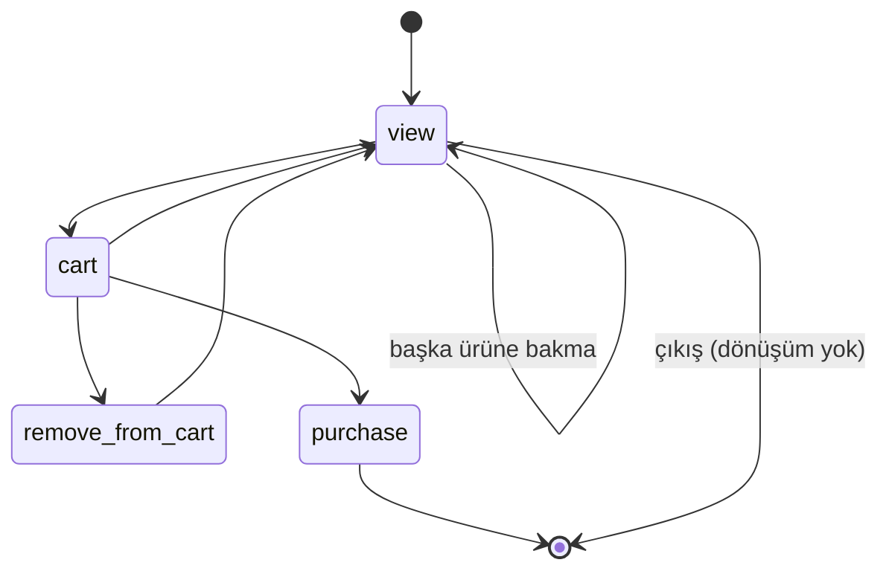
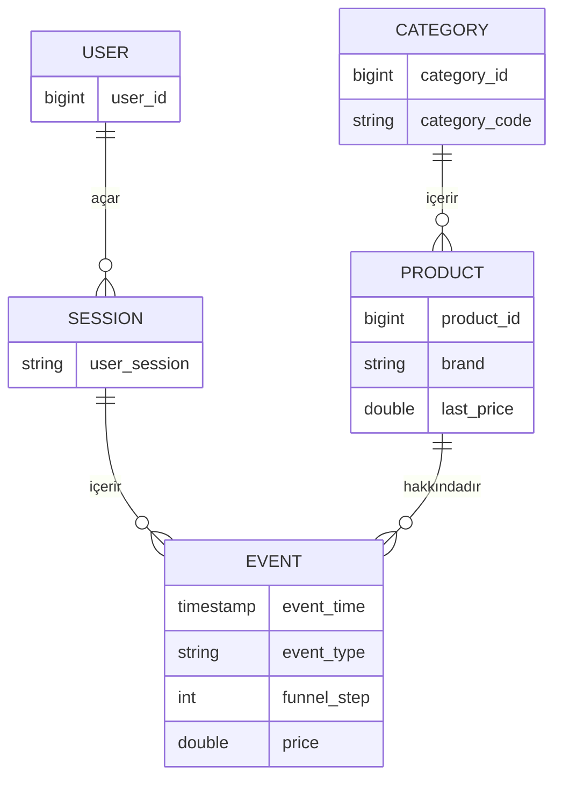

# Olay Modeli (Öğrenci 1)

## 1. Olay tipleri

Veri setindeki her satır bir **olay**dır: bir kullanıcının bir oturumda bir ürünle yaptığı tek bir etkileşim.

| event_type | funnel_step | funnel_stage | Anlamı | Not |
|---|---|---|---|---|
| `view` | 1 | goruntuleme | Ürün sayfası açıldı | Verinin büyük kısmı |
| `cart` | 2 | sepet | Ürün sepete eklendi | |
| `remove_from_cart` | 2 | sepet | Ürün sepetten çıkarıldı | Huniye göre **geri adım**, `is_remove=1` |
| `purchase` | 3 | satin_alma | Ürün satın alındı | Aynı oturumda birden fazla olabilir (tek siparişte birden çok ürün) |

Her olay için ayrıca `is_view`, `is_cart`, `is_remove`, `is_purchase` (0/1) bayrakları üretildi. Böylece
`sum(is_purchase)` gibi tek bir aggregation ile dönüşüm sayıları alınabiliyor; `CASE WHEN` yazmaya gerek kalmıyor.

## 2. Olay geçişleri (huni)

Gerçek veride bu sıra her zaman temiz değil: bazı kullanıcılar `view` olayı olmadan doğrudan `cart` yapabiliyor
(ör. liste sayfasından "sepete ekle"). Bu yüzden huni hesabında (Öğrenci 2) "önce view şart" kuralı
yerine **oturumda o aşamaya ulaşıldı mı** mantığı kullanılmalı.

## 3. Varlıklar ve ilişkiler

- **events_full** → olay (fact) tablosu, `event_month`'a göre partition'lı Parquet
- **dim_product** → ürün boyut tablosu (son kategori, marka, son/ortalama fiyat, olay sayısı)
- Kullanıcı ve oturum ayrı tablo olarak tutulmadı; olay tablosundan `groupBy` ile türetiliyor (Öğrenci 2 ve 4).

## 4. Hazırlamada verilen kararlar

| Karar | Gerekçe |
|---|---|
| `inferSchema` yerine açık şema | Büyük dosyayı iki kez okutmuyor, ID kolonları kesin `bigint` |
| `event_time` UTC'ye sabitlendi | Saat bazlı analiz bilgisayarın saat dilimine göre kaymasın |
| Geçersiz zaman/olay, boş user/ürün, negatif fiyat → silindi | Bu satırlar analiz edilemez; sayıları `kalite_ozeti.csv`'de |
| Boş `user_session` → **silinmedi** | `user_id` + zaman aralığıyla oturum yeniden kurulabilir |
| Birebir tekrar eden olaylar → silindi | Aynı zaman/tip/ürün/kullanıcı/oturum = log tekrarı |
| `category_code` → l1/l2/l3 seviyeleri | Kategori bazlı analizlerde (Öğrenci 3) seviye seçebilmek için |
| Örneklem **kullanıcı bazlı** | Satır örneklemi oturumları böler, dönüşüm oranını yapay düşürür |
| Örneklemler iç içe (100k ⊂ 1m ⊂ 5m), seed=42 | Performans farkı sadece boyuttan gelsin, herkes aynı veriyi üretsin |
